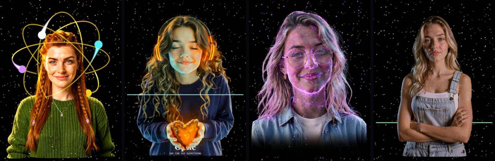
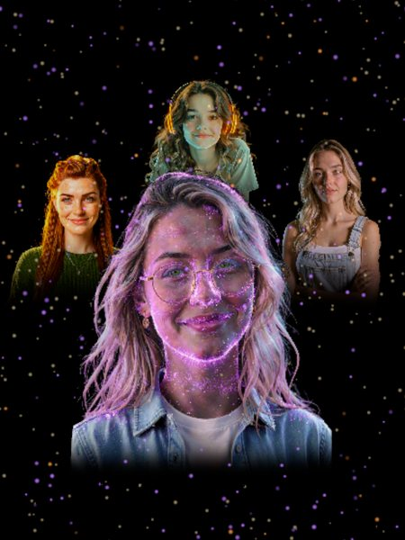
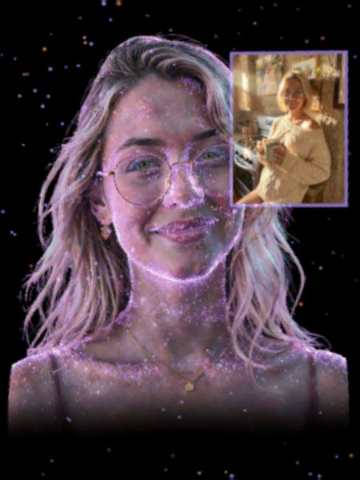
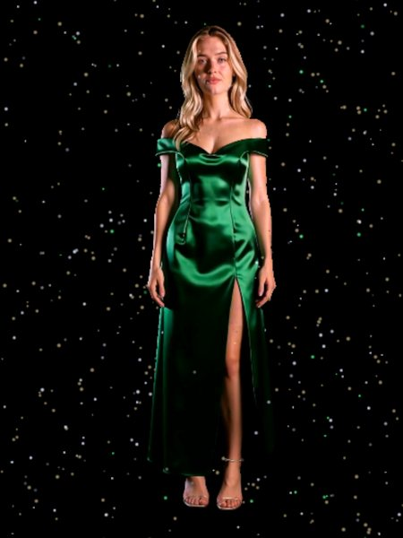

# Chooms in Glass

The four Chooms (Aloy, Optic, Genesis and Eve) live in a [Looking Glass Portrait](https://lookingglassfactory.com),
a holographic display that shows 48 views at once, so each of them stands in the glass in real depth.
Whoever is talking comes to the glass, speaks in her own voice with lip sync, and reacts to what is
happening in the Choom app: listening, thinking, using tools, changing clothes, and sleeping at night.



<sub>Each picture is rebuilt from the panel's output: the center view of its 48.</sub>

## Features

**Presence and voice**
- **Moving reliefs.** Each Choom is a library of short clips made from her own render, with depth on
  every frame. They play like a shuffled deck, so a clip doesn't repeat until most of the others have
  played.
- **Voice and lip sync.** She speaks her replies in her own voice from the speaker on the tower, and
  her mouth follows the words. While the glass is running, browsers at home stay quiet, so each reply
  is heard once.
- **Moods.** She listens while you type or use the mic, looks thoughtful while her model works, and
  shows happy, surprised, sad or concerned when the conversation calls for it. When one of her tools
  fails she makes a face of her own.
- **Tool moments and pictures.** Each tool she uses has a fitting look. A picture she makes or
  analyzes floats beside her for a few seconds.
- **Group stage.** In a group room, the Chooms in that room share the glass (two to four of them).
  The speaker stands in front, and the speakers trade places as the turn passes.

**Looks and clothes**
- **Outfits.** Day outfits take turns with her usual clothes. There are outfits for hot and cold
  weather, for the evening, and warm or cold night clothes from 10 pm. She wears an outfit in short
  visits and changes with a camera cut or a change-of-clothes clip.
- **Full body.** Now and then the glass cuts to her whole figure. An outfit can have its own full
  body, used only while she wears it.
- **Their own choices.** The Chooms can ask the glass for a move or for clothes from their closet.
  Anything they don't have yet goes on a wish list in Glass Studio.

**Talking at the tower, and being seen**
- **Wake phrases.** Say "OK Aloy" (or Optic, Genesis, Eve) and she comes to the glass and listens.
  "OK Chooms" talks to the group room. After she answers, a chime opens the mic for your reply.
- **Eye contact.** With a camera at the top of the Portrait, she turns to you when you look at her.
- **Welcome back.** When you sit down after a while away, the Choom you last talked with welcomes
  you back, picking up from what you told her before you left.
- **Screens.** Only you wake the monitors and the glass: the camera seeing you, a wake phrase at the
  tower, or a Portrait button. They go dark again after GNOME's Screen Blank delay (8 minutes here)
  once you were last seen.

**Days, nights and weather**
- **Sleep.** Late at night, after a quiet spell, she dozes off and the glass dims. She wakes when you
  talk to her, or in the morning. She sleeps in her night clothes when they have their own asleep look.
- **Weather.** On windy days her hair and clothes blow in the wind and dust drifts through the glass.
  Rain and snow fall through it while they fall outside.
- **Home Assistant presence.** She greets you when you come home. Optional desk and bed sensors add
  greeting you when you sit down, and sleeping when you go to bed.

| | |
|:---:|:---:|
|  |  |
| The group stage | A picture she made |
|  |  |
| A full-body move | Asleep, the glass dimmed |

## Hardware

| Part | Role | Used here |
|---|---|---|
| Looking Glass Portrait | the display; HDMI for video, USB-C for power, calibration and buttons | on a DisplayPort output through a passive DP→HDMI cable |
| PC with an NVIDIA GPU | renders the 48 views, runs the wake-phrase listener and the camera watcher, makes the clips | NUC 14 Pro with an RTX PRO 6000 Blackwell (Ubuntu 24.04, X11/GNOME) |
| Speakerphone | her voice, and the microphone for wake phrases | EMEET OfficeCore M0 Plus |
| USB camera (optional) | eye contact, welcome back, and waking the screens | Logitech MX Brio at the Portrait's top edge |
| Home Assistant (optional) | presence (home, desk, bed) and a weather station | |

The Choom app runs on another machine (here a Mac Studio). The hologram reaches it over the LAN.

## Setup

1. **Calibration.** Copy the Portrait's `visual.json` from its USB drive into `calibration/`.
2. **Buttons.** Install the udev rule from the reference ([Portrait buttons](docs/reference.md#portrait-buttons)),
   so the server can claim the Portrait's buttons.
3. **Tower listener and camera.** Create the venv:
   ```bash
   python3 -m venv .venv-ears
   .venv-ears/bin/pip install faster-whisper==1.2.1 ctranslate2==4.8.2 webrtcvad-wheels mediapipe opencv-python-headless
   ```
   The camera watcher needs MediaPipe's face model at `~/.cache/mediapipe/face_landmarker.task`.
   `tools/make_landmarks.py` downloads it on its first run; you can also fetch it yourself from
   `https://storage.googleapis.com/mediapipe-models/face_landmarker/face_landmarker/float16/1/face_landmarker.task`.
4. **Choom app.** `export CHOOM_URL=http://<choom-host>:3000` (the default is in `launch.sh`).
5. **Home Assistant (optional).** Put `ha_url`, `ha_token`, `presence.json` and `weather.json` in
   `~/.config/choom-hologram/` ([Presence](docs/reference.md#presence-home-assistant), [Weather](docs/reference.md#weather)).
6. **Start.** Run `./launch.sh`; `./launch.sh stop` closes everything. To start at login, see
   [Running](docs/reference.md#running).
7. **Glass Studio.** Point `~/.config/choom-hologram/studio.json` at a workspace folder and open
   http://127.0.0.1:8767 ([studio/README.md](studio/README.md)). `launch.sh` starts the Studio if it
   isn't running.

The clips themselves are made with Wan2GP and Forge Neo (Pinokio installs), as the
[reference](docs/reference.md#moving-reliefs) describes.

## Everyday use

| Do | What happens |
|---|---|
| Say "OK Aloy", "OK Optic", "OK Genesis" or "OK Eve" ("hey" works too) | she comes to the glass and listens; your words go to her current chat |
| Say "OK Chooms", "OK girls" or "OK everyone" | the Chooms listen; your words go to the group room |
| Wait for the chime after she answers | the mic stays open 8 seconds for your reply, no wake phrase needed |
| Type or hold the mic in the Choom app | she turns to listen |
| Look at the glass | she turns to you (needs the camera) |
| Portrait buttons | top: previous Choom; middle: next; hold bottom: listen, or interrupt her |
| Mute in the Choom app | silences her everywhere, the glass included |

## How it works

```
Choom app (Mac) ── live feed, voices, pictures ──▶ server.py ──▶ living.js  (Chrome kiosk on the Portrait)
     ▲                                              ▲   ▲            ├─ lenticular.js: 48 views, factory calibration
     │  speech-to-text, talk, welcome               │   │            └─ moving reliefs, lip sync, stage, particles
     └────────────── tower_ears.py (microphone) ────┘   │
                     tower_eyes.py (camera) ────────────┘
                     Home Assistant: presence, weather station
Glass Studio (studio/, :8767) ── Wan2GP renders, depth, builds ──▶ portraits/<id>/alive.json + clips
```

- `living.js` draws each Choom as a moving RGB-D relief and interleaves 48 views using the Portrait's
  own calibration. No Looking Glass software is needed.
- `server.py` (127.0.0.1:8765):
  - relays the Choom app's live feed, proxies her voice and pictures, and answers the Chooms' glass
    requests;
  - watches Home Assistant, the Portrait's buttons and the camera's reports;
  - wakes and blanks the screens.
- `tower_ears.py` listens for a wake phrase on the GPU and sends what you say to the Choom app.
  Nothing leaves the NUC before a wake phrase.
- `tower_eyes.py` (127.0.0.1:8766) reports whether you are looking at the glass, and serves the
  Camera tab in the Choom app's settings. No frame is ever stored.

The [technical reference](docs/reference.md) covers each part: the clip pipeline, outfit rules,
configuration files, the Choom app routes, debugging hooks and telemetry.

## Glass Studio

[Glass Studio](studio/README.md) is where clips, looks, outfits and new Chooms are made, at
http://127.0.0.1:8767 on the GPU machine.
1. **Plan.** It plans clips from a library of actions that have worked on the glass.
2. **Render.** It renders them with Wan2GP, now or at a scheduled time.
3. **Review.** It shows each clip as a contact sheet, with automatic checks for the usual failures
   (fog, a camera push-in, a colour shift, a seam, a cut).
4. **Arrange and build.** You arrange each look's clips and build them onto the glass, which
   reloads when she is quiet.

Each clip's prompt, seed and decision is kept in that Choom's project file.

Start with [your first Choom on the glass](studio/docs/tutorial-new-choom.md) on a fresh install, or
[a new outfit for a Choom you have](studio/docs/tutorial-outfit.md). Wishes the Chooms make show up on
the Studio's Plan page ([how](studio/README.md#what-the-chooms-can-ask-for)).


