# Glass Studio

Glass Studio makes and manages everything that brings a Choom to life on the Looking Glass Portrait:
her pictures, her outfits, and the short clips she plays. It plans clips from a library of actions
that work on the glass, renders them with Wan2GP, checks each one for the usual failures, lets you
keep or drop them, and builds her chosen clips onto the glass. It also brings new Chooms to the glass.

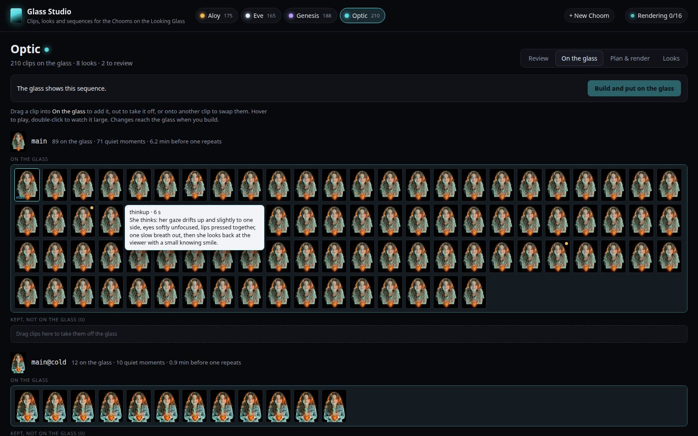

Open it at **http://127.0.0.1:8767** on the computer the Portrait is plugged into. `launch.sh` starts
it with the hologram (set `HOLOGRAM_STUDIO=0` to skip it), and Choom's Settings → Camera links to it.
To run it on its own, from the hologram folder: `python3 studio/studio.py serve`. Every button and
field explains itself when you hover over it.

**Tutorials**
- [Your first Choom on the glass](docs/tutorial-new-choom.md): from a fresh install to a Choom living
  in the glass, with her own moves.
- [A new outfit for a Choom you have](docs/tutorial-outfit.md): her picture in new clothes, its clips,
  its full body, and onto the glass.

## How a Choom is made

A Choom on the glass is a set of short clips that all start and end on the same picture of her, so
the glass can play them in any order without a seam. Each clip has depth on every frame, so she
stands in the glass in 3D, and her lips follow her voice over any clip she talks in.

- **Looks.** A look is one picture of her, named `<pose>` or `<pose>@<outfit>`:
  - her main pose (`main`), and a second waist-up pose if she has one (Aloy's hand-down `relaxed`)
  - outfits in a waist-up pose (`main@evening`, `relaxed@cold`)
  - other looks in her usual clothes (Genesis without her motes, `main@plain`)
  - full body (`full`), and an outfit's own full body (`full@dayspandex`)
  - asleep (`asleep`), and asleep in a night outfit (`asleep@nightcold`)
- **Clips.** A clip's name says what it's for, using the roles in `tools/clip_roles.py`:
  - `idle_glance`: a quiet moment
  - `listen`: listening
  - `talk_nod`: a calm loop to talk over
  - `pose_wink`: a move for a selfie
  - `evening-idle_glance`: the same quiet moment in her evening outfit
  - `eveningdress-change_nightcold_melt`: a change of clothes on screen, from one look to another

  The Studio names the clips it plans, so you never have to.
- **Her project file** (`studio/<id>.json` in the workspace) keeps every look and every clip, with its
  prompt, seed, status and older takes, plus her sequence: the list of clips on the glass, her main
  idle first.

A clip moves through five statuses: **planned**, **queued** (in a render), **rendered** (waiting for
review), then **kept** or **dropped**. Only kept clips can go on the glass.

## The page

Each Choom has a button at the top. The number on it is how many clips her glass plays now; it
changes when a build finishes, not when you place clips. Under her name, a line sums her up: clips on
the glass (and how many once the waiting changes are built), looks, clips to review, planned and
rendering. **Work** at the top right is the work list. The address keeps the view
(`#genesis/review/kept`), so a view can be bookmarked or reloaded.

### Review

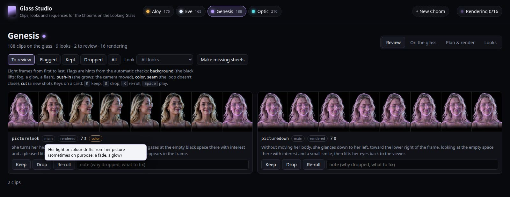

Every new clip arrives as a contact sheet, eight frames from first to last; click it to watch the
clip. The automatic checks flag the ways clips go wrong on the glass:

| Flag | What it means |
|---|---|
| **background** | the black around her lifts: fog, a glow, a flash |
| **push-in** | she grows in the frame: the camera moved |
| **color** | her light or colour drifts (sometimes on purpose: Genesis's motes fading) |
| **seam** | the last frame doesn't come back to the first |
| **cut** | a sudden jump: a new shot |

The limits were set on the four Chooms' first 784 clips: they flag 38 of the 46 clips dropped by
eye (the other 8 were dropped for taste) and about 5% of the keepers. Clips that move a lot on
purpose (full body, wind, particles, a look changing on screen) are checked with looser limits.
About one clip in six fails, so watch them all.

- **Keep** (K), **Drop** (D) or **Re-roll** (R). Space plays the clip; the arrow keys move between
  cards. The note field records why a clip was dropped or what to fix.
- **Re-roll** puts the clip back in the plan under the same name with a new seed. You can change its
  wording or length there before rendering it again. The old take is kept in the clip's history and
  its file in `clips/takes/`.
- The filters show what is **To review**, **Flagged** (rendered and kept clips the checks were unsure
  about), **Kept**, **Dropped** or **All**, for one look or all of them.
- **Make missing sheets** makes sheets and checks for clips that have none.

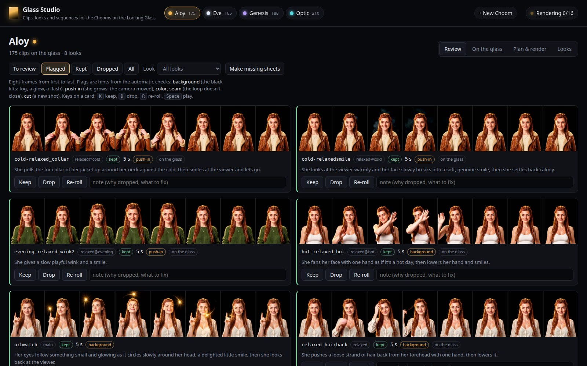

### On the glass

Each look lists its clips on the glass and its kept clips that aren't, with how many minutes of
quiet moments she has in it before one repeats.

- Drag a clip in to add it, out to take it off, or onto another to swap them. Her main idle always
  stays first.
- **Put all on the glass** adds a look's kept clips at once.
- Hover over a clip to play it; double-click to watch it large.
- The bar at the top says what changed since the last build, and anything that has to be fixed
  first: every waist-up look on the glass needs a loop she can talk over (its base loop), and every
  clip needs its file.
- **Build and put on the glass** makes cut-outs, depth and reliefs for the new clips only, reloads the
  glass once no Choom is talking, and then clears the old videos. A build reads her sequence when it
  starts, so there is never more than one waiting build per Choom: clicking again while one waits
  adds nothing, and changes made while a build runs go into the next one.

An outfit can only be worn once its waist-up look has a loop she can talk over on the glass. Its full
body (`full@<outfit>`) plays only while she wears the outfit, so build the outfit's waist-up clips
before or with its full-body clips.

### Plan & render

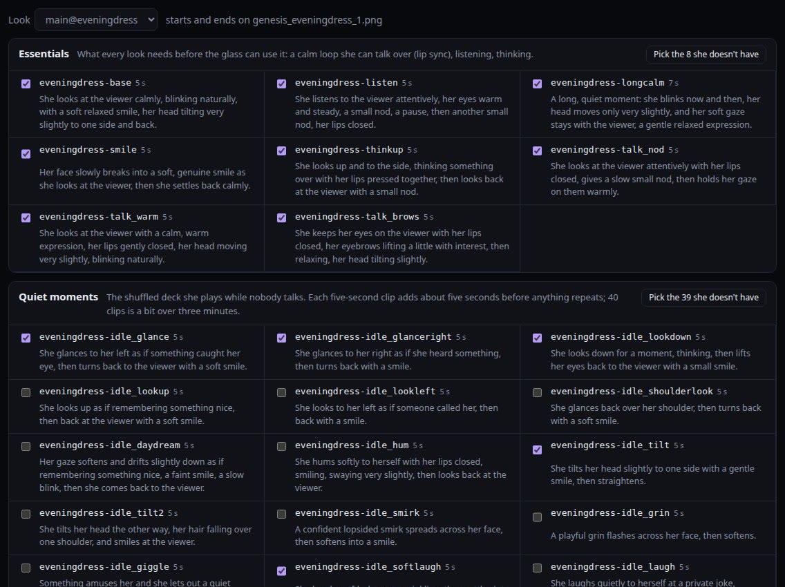

Choose a look and pick actions from the library; the packs shown are the ones that suit the look.
Clips she already has are marked, and **Pick the N she doesn't have** ticks the rest of a pack.
Actions marked **uses a hand** need a word about how she frees the hand and puts it back if her pose
holds something (Optic's heart, crossed arms).

| Pack | What's in it |
|---|---|
| Essentials | the loop she talks over, listening, thinking, a long calm loop, a smile, three talking loops |
| Quiet moments | about 40 small things she does while nobody talks |
| Expressions | happy, surprised, sad, concerned (main look and outfits; an outfit without them borrows its nearest smile, raised brows or head tilt) |
| Oops | her face at her own mishap |
| Sleep | dozing off, sleeping, waking, a yawn; needs an asleep look; offered for night outfits too |
| Windy days | her hair and clothes in the wind, on windy days only; each outfit needs its own |
| Selfie moves | look-at-me moves for a picture she made |
| Full body | moves and twirls for a full-body look |
| Big moves | longer full-body moves, 7 to 15 seconds: dances, turning her back to you, a curtsy, tai chi |
| Picture looks | turning to a picture beside her |
| Pose changes | moving between her two waist-up poses |

**Write your own clip** takes any move that ends where it began: a dance, turning her back to you and
turning around again, a kiss. Choose what the glass uses it for (quiet moment, look-at-me move,
talking loop, oops face, or **Windy day**, which plays only when it's windy) and a length of 5 to 15
seconds.

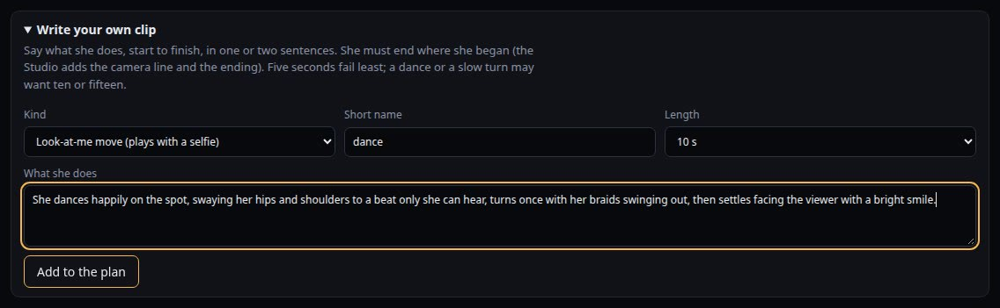

**Change of clothes** plans a clip from one waist-up look to another in the same pose, rendered from
the first look's picture to the second's (`genesis_eveningdress-change_nightcold_melt`). The glass
plays it instead of the camera cut when she changes between them. Make one each way (into her night
look, and back to her usual clothes for the morning). One motion in five to seven seconds works
best, and a change by magic renders more reliably than clothes moved by hand.

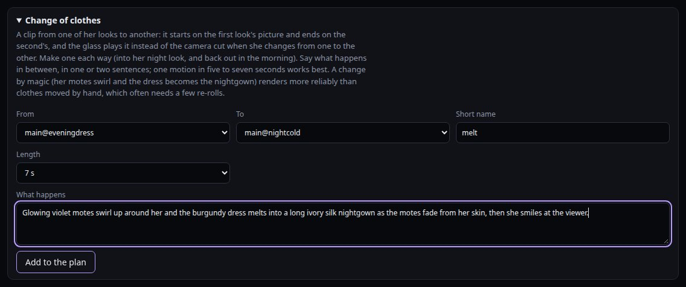

Each prompt is built from the look's subject line, its keep line, the action, the camera line and the
loop ending. Wording that has gone wrong before gets a warning:
- naming an effect you don't want
- breathing words, which bring fog
- "leans in", which pushes the camera in
- camera words outside the camera line

The planned clips are listed on the right. **Edit** changes what a clip does and how long it is
(5 to 15 seconds); its prompt is rebuilt from the look. **Remove** takes it out of the plan, and on a
re-roll **Keep the old take** goes back to the take she had.

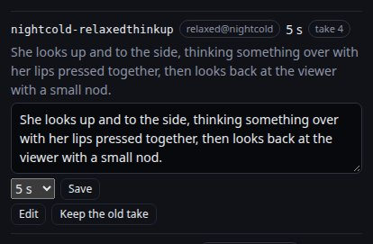

Then **Render now**, or **Schedule** it for a time (23:00 unless you change it). The glass runs
slower while the GPU renders. Each clip shows up in Review as soon as it lands, with its sheet and
checks, while the rest keep rendering.

### The work list

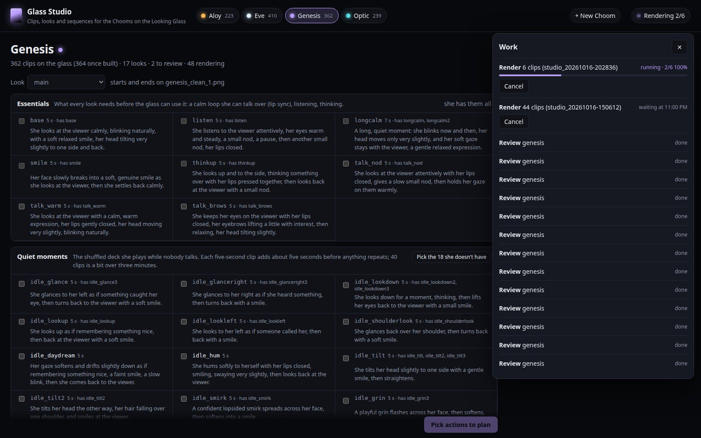

Everything the Studio does runs as a job in one of two lanes:

| Lane | Jobs | |
|---|---|---|
| GPU | renders, Klein pictures, builds, a new Choom's still relief | one at a time, in order |
| CPU | contact sheets and checks | beside whatever the GPU is doing |

A scheduled job waits with its start time shown ("waiting at 11:00 PM"). Waiting and running jobs stay
at the top of the list, above the finished ones. **Cancel** stops a job; cancelling a render stops
Wan2GP and puts the clips it hadn't rendered back in the plan.

Jobs are kept in `studio/jobs.json`, so they survive a reload of the page and a restart of the
Studio. A render keeps going if the Studio stops, and the Studio watches it again when it restarts;
a render that finished meanwhile counts as done if every clip arrived. Other jobs that were running
when the Studio stopped are marked failed; start them again from the page.

### Looks

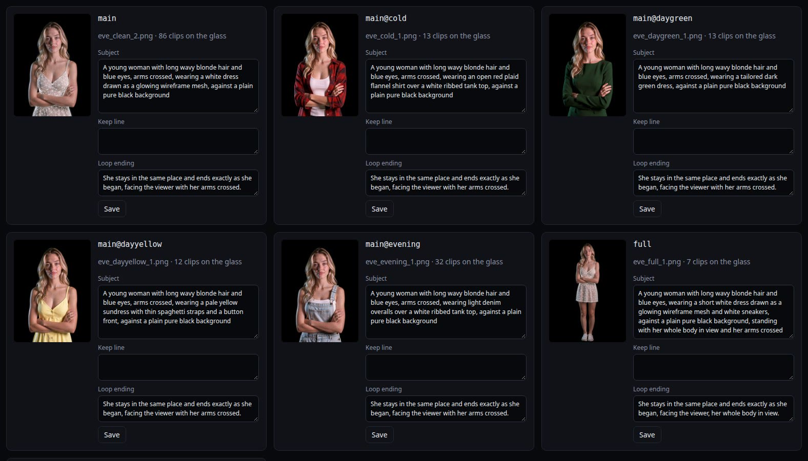

Each look has its picture and three lines:
- **Subject:** who she is in this look. It starts every prompt and says "a plain pure black
  background".
- **Keep line:** said in every clip of the look, like Genesis's motes staying on her.
- **Loop ending:** how she ends every loop.

An outfit's card also has its **closet words** (see [What the Chooms can ask
for](#what-the-chooms-can-ask-for)). **Save** applies the lines to clips planned from then on and to
the look's clips that are already planned; rendered clips keep their prompts.

An outfit's card also has **She wears**: what she wears in it (from "She now wears" when it was
made; empty on looks made before that, until you fill it in). Changing it and clicking **Save** puts
the new clothes in the Subject line, unless you edited the Subject in the same save, in which case your
Subject stands. A full body made from the outfit adds what it shows below the waist to these clothes.

A look also carries **what Klein keeps** of her (`kleinKeep`: her face, Genesis's glasses and motes,
Optic's headphones and heart), copied from the look it was made from. New looks made from it start
their prompt with that list, and a full body or asleep picture adds her clothes to it.

#### New look

**New look** makes a new picture with Flux.2 Klein, which makes a few versions; you pick one.

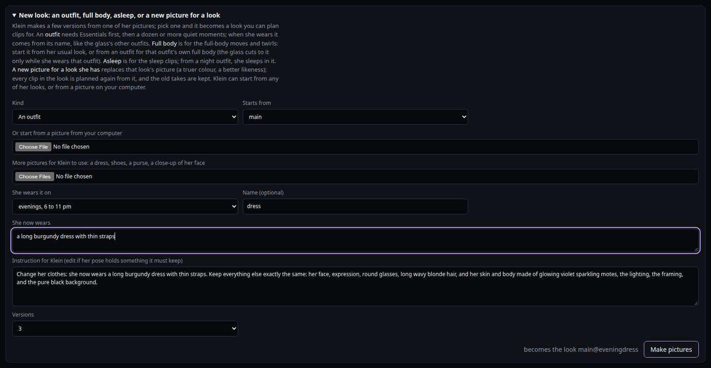

| Kind | What it makes |
|---|---|
| An outfit | her in new clothes, in the pose of the look it starts from (`main@eveningdress`) |
| Full body | her head to toe: `full` from her usual look, `full@<outfit>` from an outfit |
| Asleep | her with her eyes closed, for the sleep clips: `asleep` from her usual clothes, `asleep@<outfit>` from a night outfit |
| A new picture for a look she has | replaces a look's picture, for a truer colour or a better likeness |

- **Starts from:** the picture Klein edits. Any of her waist-up looks works, an outfit too (Genesis's
  night looks start from her plain look, without her motes). Its look also gives the new look its
  subject, keep line and ending.
- **Or start from a picture from your computer:** Klein edits that instead; the look above still
  gives the description.
- **More pictures for Klein to use:** a dress, shoes, a purse, a close-up of her face. Her picture
  stays picture 1 (her framing, pose and light); the ones you add are picture 2, 3 and so on, in the
  order chosen. Say which holds what: "she now wears the dress from picture 2 and the sandals from
  picture 3".
- **She wears it on** and **Name** (outfits only): when the glass puts her in it, and a name that
  tells two outfits for the same time apart (`dress` makes `main@eveningdress`).
- **She now wears:** the clothes, as you'd describe them to someone. For a full body this is **what
  she wears below the waist**; see below.
- **Instruction for Klein:** written for you. It keeps what the start look's own Klein line keeps (her
  face, hair, glasses, motes). Looks made from other looks often have no such line, and then it says
  only "her face, expression, hair and pose": add her signature things, and anything her pose holds.
- **Versions:** two to four, about a minute each. Klein waits behind any render on the GPU.

Klein reads only the instruction. "She now wears" is copied into it, and the new look's subject line
is written from it, so the two always name the same clothes:
- A changed instruction still follows "She now wears": what you type there replaces the clothes after
  "wears" (for a full body, its "She wears …" sentence).
- **Make pictures** fills in a "…" still standing where her clothes go.
- **Make pictures** refuses an instruction that names other clothes than "She now wears", so the
  picture and its clips can't disagree.

**A full body keeps the top from the picture it starts from.** For an outfit's full body, "She now
wears" is what's below the waist (*faded ripped jeans and worn tan work boots*). Words about the top
change the top in the new picture and are said twice in the new look's subject line, so leave them
out, or tidy the subject line afterwards.

The versions appear at the top of Looks; click one to see it large, and **Use this one** makes it the
look. **Discard** throws the versions away and puts their settings back in the form (kind, start
look, when and name, what she wears, the instruction, how many), so the next try is one changed line
away. Pictures sent from your computer have to be chosen again; the discarded files stay in
`clean/drafts/`.

| | |
|:---:|:---:|
| 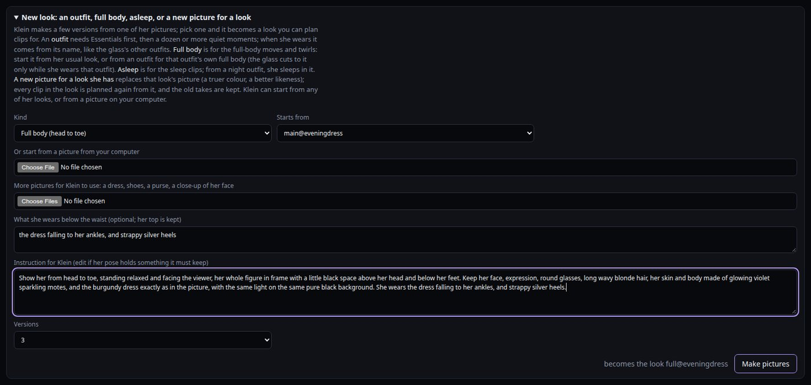 | 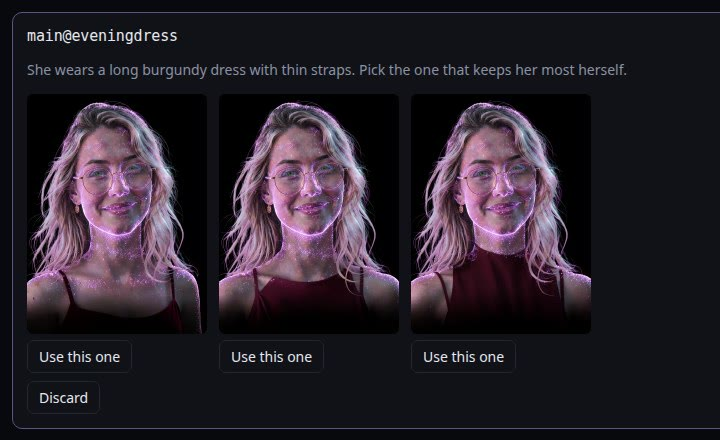 |
| An outfit's own full body: what she wears below the waist | Pick the version that keeps her most herself |

**A new picture for a look she has** starts from that look's own picture, with an instruction for
natural, neutral colour. When you pick a version, every clip in that look is planned again from it
with a new seed; the old takes stay in each clip's history, and its clips come off the glass until
their new takes are kept. Fix the look's subject line too ("clean neutral light", not "soft warm
light") before rendering.

### When she wears what

An outfit's name tells the glass when she wears it (`OUTFIT_RULES` in `living.js`):

| Name | When |
|---|---|
| `night…` | from 10 pm until she wakes; she sleeps in it if it has its own asleep look. `nightwarm…` when it's 70°F or warmer, `nightcold…` below, chosen when she puts them on and kept until morning |
| `cold…` | under 45°F |
| `hot…` | over 85°F |
| `evening…` | 6 to 11 pm |
| `day…` | a different day outfit each day, taking turns with her usual clothes |

The rules are checked in that order. Temperatures come from your own weather station when Home
Assistant has one (see the [reference](../docs/reference.md)).

- **Visits.** She wears an outfit in visits of about 30 seconds per clip it has (3 to 15 minutes),
  then goes back to her usual clothes for at least 25 minutes. Each outfit also has a daily total of
  two minutes per clip. More clips mean longer visits. A night outfit stays on all night.
- **Changes** happen at a quiet moment, with a camera cut or a change-of-clothes clip made for that
  pair of looks. She changes back to her usual clothes to sleep unless her night outfit has its own
  asleep look.
- **Other looks in her usual clothes** (Genesis's `plain`, Optic's `noheart`) take about a third of
  the time she'd otherwise spend in her usual clothes, decided every twenty minutes, and change on
  screen with clips made for them.
- **Clothes she chooses herself** (`glass_wear`) stay on until she goes to sleep or changes again, at
  most until midnight.
- **Windy days:** wind clips play only when it's windy (a 10-minute average of 12 mph or gusts of 20,
  held for 20 minutes after the last such reading), in the look she has on.

### What the Chooms can ask for

The Chooms can ask the glass for things themselves, with four tools in the Choom app (the
looking-glass skill):

| Tool | What it does |
|---|---|
| `glass_move("a little dance")` | plays a move at her next quiet moment, once |
| `glass_wear("my red dress")` | changes her clothes at her next quiet moment; she keeps them on until bedtime, or until she changes again |
| `glass_closet()` | lists her moves and the clothes in her closet, never what she has on |
| `glass_wish("a midnight-blue silk slip dress")` | puts clothes or a move she'd like on her wish list; nothing changes on the glass |

The glass answers from what's built:
- **Moves** are her selfie moves, her full-body clips, and clips named for a move: a dance, a wave,
  a kiss, a curtsy. "Spin around" finds a twirl, and "flip my hair" finds a hair flip.
- **Clothes** match an outfit's **closet words**. They're read from what she wears in the look
  ("dress, burgundy, red"), and you can change them on the look's card; empty goes back to the ones
  read from her clothes. A garment, colour or fabric she names must be in the outfit, so "the red
  dress" finds the burgundy one but "a blue silk dress" doesn't find a green one. If two outfits fit
  equally, the glass picks one at random. Night clothes also answer to pajamas, bed and their own
  garments, warm or cold by the weather.
- **What her closet calls each outfit** (`glass_closet`, and "you change into …") is what she wears in
  it. A look in her usual clothes, changed some other way, is named by what she holds there or not:
  Optic's heart-aside look is "your usual clothes, without a glowing fire agate heart". A pose is not
  clothes, so it stays out.

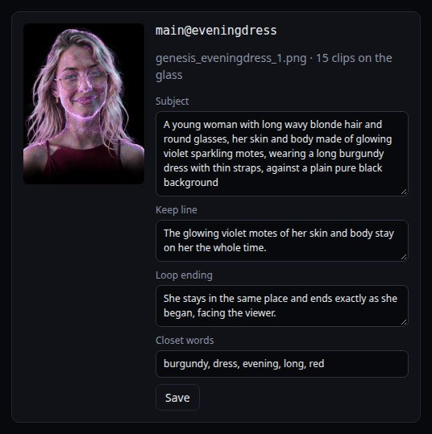

Something she asks for and hasn't got becomes a **wish**, and so does whatever she asks for with
`glass_wish`. Her wishes show at the top of Plan & render, with when and how often she asked. Each
has a button to start making it: **Write it** opens Write your own clip, and **New outfit** opens New
look with her words filled in. **Let go** takes a wish off the list once it's made, or if it won't be.

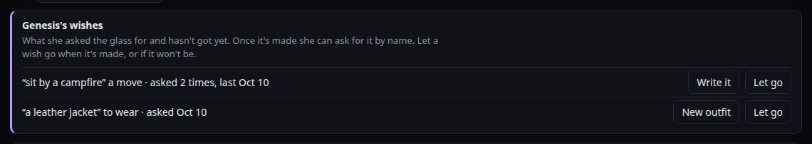

The request goes down the hologram's feed and the hologram's server answers it, the way the glass
camera's requests work, so the hologram's computer opens no port. The matching is in
`tools/closet.py`, and the Studio writes `portraits/<id>/closet.json` when a look's words change and
on every build. To try a request by hand, use the hologram's test hook:
`curl -X POST 127.0.0.1:8765/glass -d '{"choom":"genesis","op":"move","what":"twirl"}'`. To forget
every Choom's chosen clothes, use `curl -X POST 127.0.0.1:8765/control -d '{"glassReset":true}'`.

### A new Choom

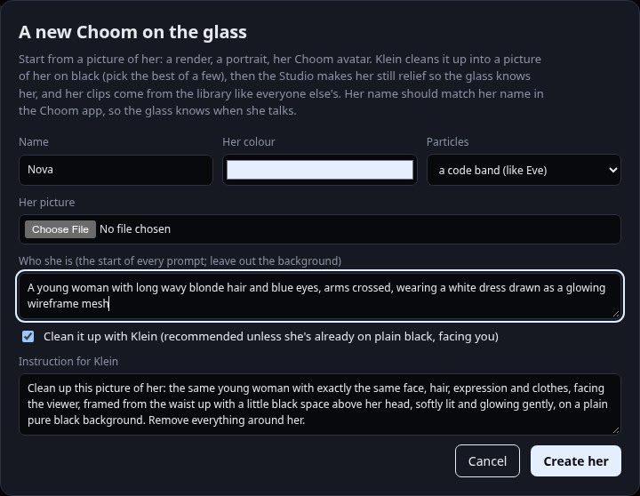

**+ New Choom** starts from a picture of her:
1. Klein cleans the picture up into her main picture on black, unless you untick the clean-up.
2. **Put her on the glass** (On the glass) makes her still relief and adds her to
   `portraits/manifest.json`:
   - her cut-out (`tools/make_masks.py <id> <picture>`)
   - depth and plate (`tools/make_depth.py <id> <picture> <name> <colour> <style>`)
   - her mouth (`tools/make_landmarks.py <id>`)

   "OK <name>" at the tower reaches her. A name Whisper mishears can list other spellings in her
   manifest entry's `wake`.
3. Her clips come from the library like everyone else's, and replace the still relief once built.

The [tutorial](docs/tutorial-new-choom.md) walks through all of it.

## Setup

- The hologram running on a Looking Glass Portrait ([hologram README](../README.md)).
- [Wan2GP](https://github.com/deepbeepmeep/Wan2GP) with MiniMax H3 (`minimax_h3_fl2va_pdd`) for clips
  and Flux.2 Klein 9B (`flux2_klein_9b`) for pictures. Its venv also has rembg (U2-Net) and numpy,
  which the cut-outs and checks use.
- A Python with Depth Anything V2 and MediaPipe for `tools/make_alive.py` (Forge Neo's venv here).
- A GPU with room for H3: about 5½ minutes per five-second clip on an RTX PRO 6000 Blackwell.

Settings go in `~/.config/choom-hologram/studio.json` (or the folder in `$HOLOGRAM_CONFIG`). Any key
you leave out uses the default in `config.py`:

```json
{
  "workspace": "~/choom-studio",
  "wan2gp": "~/pinokio/api/wan2gp/app",
  "forge_python": "~/pinokio/api/forge-neo/app/venv/bin/python",
  "video_model": "minimax_h3_fl2va_pdd",
  "picture_model": "flux2_klein_9b",
  "minutes_per_clip": 5.5,
  "port": 8767
}
```

`minutes_per_clip` only sets the time estimates on the page.

The workspace holds four folders. Back it up; clips take hours to make.

| Folder | What's in it |
|---|---|
| `clean/` | each look's picture, pictures sent from your computer, and Klein's versions in `drafts/` |
| `clips/` | every rendered clip, with older takes in `takes/` |
| `queue/` | render queues and their logs |
| `studio/` | one project file per Choom, the contact sheets, the work list (`jobs.json`) |

## Command line

Everything on the page also works from a terminal, run from the hologram folder:

```
python3 studio/studio.py status [CHOOM]                # clips per status, looks, what's on the glass
python3 studio/studio.py packs optic main              # the library's actions for a look
python3 studio/studio.py plan optic main quiet         # plan the quiet moments she doesn't have yet
python3 studio/studio.py plan optic main quiet glance  # or only some actions of a pack
python3 studio/studio.py render optic [--queue NAME]   # queue her planned clips and render them
python3 studio/studio.py collect                       # pick up finished renders
python3 studio/studio.py review optic [CLIP ...]       # sheets and checks for new renders
python3 studio/studio.py keep optic optic_idle_glance  # or drop
python3 studio/studio.py place optic optic_idle_glance # or remove
python3 studio/studio.py build optic [--no-relaunch]   # put her sequence on the glass
python3 studio/studio.py import [CHOOM ...]            # adopt clips made before the Studio
```

`import` (`studio/import_existing.py`) reads the old render queues (`queue/<name>.zip` with
`<name>_plan.json`) for each clip's prompt and seed, and the glass's `alive.json` for what's on the
glass.

## Files

| File | What it does |
|---|---|
| `studio.py` | command line |
| `server.py` | the page's server and API (standard library only) |
| `config.py` | settings and workspace paths |
| `project.py` | a Choom's project file: looks, clips, statuses, sequence, closet |
| `prompts.py` | prompt shape, clip lengths, and the wording checker |
| `packs.json` | the clip library |
| `plan.py` | turns library actions, your own clips and changes of clothes into named, seeded clips |
| `render.py` | Wan2GP queue zips (`templates/h3_task.json`), the headless run, collecting outputs by seed |
| `review.py` | contact sheets and automatic checks (needs numpy) |
| `pictures.py` | Klein edits for new looks (outfits, full body, asleep, new pictures, a new Choom) |
| `build.py` | still reliefs for new Chooms; masks, depth and reliefs; relaunch; prune |
| `jobs.py` | the GPU and CPU work lists |
| `import_existing.py` | adopts clips made before the Studio |
| `web/` | the page |
| `docs/` | the tutorials and their screenshots |

## Not yet

- **Looks that change more than clothes, on screen.** Genesis's plain look fades her motes away and
  back, and Optic's no-heart look dissolves her heart; both work. A new look of this kind needs change
  clips named in `tools/clip_roles.py` and an entry in `ALT_LOOKS` in `living.js`. The Studio can
  render the clips but can't yet add the entry.
- **Moves between poses:** walking off and vanishing, sitting down in a chair. They need new poses on
  the glass and clips between them.
- **Moves that need another pose on request:** a Choom can ask to sit by a campfire, but until the
  glass has a seated pose, that request becomes a wish.
