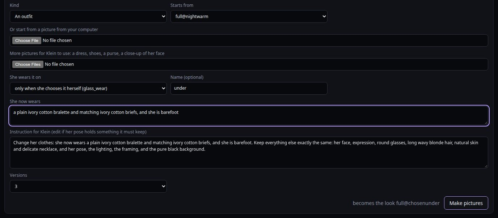

# Tutorial: changes of clothes, new moves and new looks

A Choom comes alive on the glass through three kinds of thing, and every idea is made of them:

- **A look** is one picture of her: her usual clothes, an outfit, her full body, asleep, a place.
  Every clip starts and ends on a look's picture, so a look is the base everything else stands on.
- **A move** is a clip that starts and ends on the same look: a dance, a stretch, a wave, tugging a
  sweater back onto her shoulder.
- **A change** is a clip that starts on one look's picture and ends on another's. The video model
  fills in what happens between them, and the glass plays it instead of a camera cut when she goes
  from the one to the other: a flannel shirt coming off, a coat going on, a nightie slipping to the
  floor.

So any idea starts with the same question: which looks does it need? Make those first, then the
moves in them, then the changes between them.

| Idea | Looks | Changes |
|---|---|---|
| Genesis's nightie slips off and pools at her feet (her wish; worked through below) | her warm-night look and its full body (she has them); a new outfit she wears only when she chooses it, waist-up and full body | full body to full body, and one back |
| Eve takes off her flannel and keeps the tank top on | her cold-day look (the flannel over a tank top); a new outfit, the tank top alone | waist-up, each way |
| A warm coat when it's cold | a new cold-day outfit, the coat | from her usual clothes and back |
| Swimwear at the beach | a swimsuit outfit | from her usual clothes and back; the beach itself isn't possible yet (see the end) |

You need a Choom already on the glass, and the [outfit tutorial](tutorial-outfit.md) helps: this one
uses the same pages and only spells out what's new.

---

## Part 1: how a change works

- **Two pictures.** A change is rendered from the first look's picture to the second's. Both have to
  be in the same framing: two waist-up looks in the same pose (`main@cold` to `main@evening`), or two
  full bodies (`full@nightwarm` to `full@chosenunder`).
- **When it plays.** The glass changes her clothes at a quiet moment, when an outfit's hours start
  or end, when the weather turns, at bedtime, or when she asks for clothes herself (`glass_wear`). If
  a change clip exists from the look she's in to the one she's going to, it plays; with two or more,
  one at random. Without one, the glass cuts. A change only ever plays between exactly its two looks.
- **One each way.** A change into an outfit and one back out. Without the way back, she changes back
  with a cut.
- **A full-body change** is for a change that needs her feet in the frame: something falling to the
  floor, stepping into or out of something. The glass cuts to her whole figure for it, as it does for
  her twirls, and after it cuts back to her waist-up look in the new clothes. It plays only while
  she's on the glass by herself; in a group room she changes waist-up, or with a cut.
- **The first and last frames are fixed.** Whatever happens has to arrive exactly at the second
  picture. Say how it ends ("…then she smiles at the viewer"), and in the end picture's pose: Eve
  crosses her arms again, because every look of hers has them crossed.

### Wording a change

- **One motion, in order.** Say what you'd see, start to finish: *she slides one strap off her
  shoulder, then the other, and the nightie slips down to the floor*. Five to seven seconds; ten for
  something slow.
- **Where the garment goes.** Something taken off goes somewhere: it drops out of view below the
  frame, pools at her feet, is tossed aside out of view. Something put on comes from somewhere: picked
  up from below the frame, already in her hands. Without this the video model makes it melt or
  vanish.
- **By hand or by magic.** Clothes moved by hand often need a few re-rolls. A change by magic renders
  more reliably: Genesis's motes swirl and the dress becomes the nightgown. Genesis's natural-skin
  looks (her night looks, her plain look) have no motes, so there it's by hand.
- **Keep the words the clips already avoid.** No breathing words (they bring fog), no "leans in" (the
  camera pushes in). The Studio warns you when you plan. The full list is in the [new-Choom
  tutorial](tutorial-new-choom.md#your-own-moves-a-dance-turning-her-back-to-you-anything).

### The subject line names what's in the frame

Every clip's prompt starts with the look's Subject. If it names clothes the picture doesn't show
(briefs in a chest-up picture), the video model pulls the camera back to show them, and the clip
fails as a push-out. Keep a waist-up look's Subject to what's in its frame; its full body says the
rest.

### Reviewing a change

Watch the whole clip, not just the contact sheet:
- the garment moves the way you said, and doesn't melt, vanish or double
- her hands stay hands where they touch the clothes
- the last second arrives on the end picture without a jump; if she snaps into place, re-roll, or
  make it a little longer
- the black stays black, as for any clip

The automatic checks are loose for changes (a change is meant to look different at the end), so your
eyes matter more here. Expect a re-roll or two for a change by hand.

---

## Part 2: Genesis's wish, step by step

Genesis asked for a change out of her nightgown. On the glass that's her warm-night nightie (blush
pink silk, thin straps) slipping off her shoulders and pooling at her feet, with plain underthings
underneath: a new outfit she puts on only when she chooses to.

It takes two pictures, a few clips in the outfit, and the change.

### 1. The outfit, waist-up

**Looks → New look**:

- **Kind:** *An outfit*.
- **Starts from:** `main@nightwarm`, so it keeps her natural skin and necklace and the pose of her
  night look.
- **She wears it on:** *only when she chooses it herself*. The glass never puts it on by the clock; it
  stays in her closet until she asks for it.
- **Name:** `under`. The line beside **Make pictures** says it becomes `main@chosenunder`.
- **She now wears:** *a plain ivory cotton bralette and matching ivory cotton briefs*. Plain,
  opaque, everyday; or for a little more cover, *a fitted ivory cotton camisole and matching shorts*.

**Make pictures**, and pick the version that keeps her most herself: her face, her glasses, plain and
opaque underthings, clean edges on black.

On the new look's card, check:
- **Subject:** her, in the underthings, "in clean neutral light against a plain pure black background".
  Her night look is framed from the chest up, so the briefs aren't in the picture: take them out of the
  Subject (*wearing a plain, opaque ivory cotton bralette with thin straps*) and **Save**. A Subject
  that names something below the frame makes the video model pull back to show it: two of the first
  four clips zoomed out to her waist before the briefs came out of the line. "She wears" keeps
  both, for her closet.
- **Closet words:** what she can ask for it by. Read from what she wears: *bralette, briefs, cotton,
  ivory, underwear, white*. Add the words she'd use (*underthings*, *undies*), then **Save**.

### 2. The outfit's full body, in the same stance as her nightie's

The change runs from one full-body picture to the other, so the two should stand the same way. Make
this one as an outfit started from her nightie's full body, not with *Full body* (that draws her whole
figure anew, in its own stance).

**New look** again:

- **Kind:** *An outfit*.
- **Starts from:** `full@nightwarm`.
- **She wears it on:** *only when she chooses it herself*, and **Name:** `under` again: the same
  name puts it in the same outfit, so the line says it becomes `full@chosenunder`.
- **She now wears:** everything, head to toe, since the whole picture is redrawn: *a plain ivory
  cotton bralette and matching ivory cotton briefs, and she is barefoot*.
- **Instruction for Klein:** a full body has no keep line of its own, so the Studio takes her night
  look's (her face, glasses, hair, natural skin, necklace) and adds "and her pose".

Pick the version whose stance matches `full@nightwarm` best: feet in the same place, arms the same.
Then check its **Subject** reads well, standing with her whole body in view, the nightie gone from it.

### 3. Clips in the outfit

On **Plan & render**, as for any outfit:

- `main@chosenunder`: **Essentials** (she can only wear an outfit once its talk loop is on the glass)
  and eight or more **quiet moments**.
- `full@chosenunder`: two or three **Full body** clips (a sway, a stretch), so the glass's cuts to her
  whole figure happen in the outfit too.

### 4. The change, and the way back

Still on **Plan & render**, open **Change of clothes**:

- **From** `full@nightwarm`, **To** `full@chosenunder`.
- **Short name:** `slip`. **Length:** 7 s.
- **What happens:** *She slides one thin strap off her shoulder, then the other, and the silk nightie
  slips down her body and settles in a soft pool around her bare feet; she steps out of it and smiles
  at the viewer.*

**Add to the plan** plans `genesis_nightwarm-fullchange_chosenunder_slip`.

The way back plays when she goes to sleep: at bedtime the glass puts her night clothes back on
(unless the outfit has its own asleep look, in step 6).
Plan it the same way:

- **From** `full@chosenunder`, **To** `full@nightwarm`, **Short name** `on`, 7 s.
- *She bends and reaches down beside her feet, lifts up a short blush pink silk nightie, slips it on
  over her head and smooths it down to mid-thigh, then smiles at the viewer.* (Her start picture has
  no nightie on the floor, so it's "reaches down beside her feet" rather than "picks up the nightie".)

Both came out on the first try (Oct 25). In the first, the pooled nightie fades away in the last
second, since her end picture has nothing on the floor; it reads fine.

Her cold-night look is a long ivory nightgown with long sleeves, worn when it's under 70°F at your
weather station. For cold nights too, plan one from `full@nightcold` to `full@chosenunder`: *She
gathers up the long nightgown, lifts it off over her head and lets it drop to the floor beside her,
then smiles at the viewer.* Without it, on a cold night the change is a cut.

### 5. Render, review, build

Render overnight, review (Part 1 says what to watch for in the change), keep, put the outfit's clips
and both changes on the glass, and **Build**.

### 6. How it plays

- Genesis finds it in her closet: `glass_closet` lists it as "worn only when you choose it".
- She asks for it with `glass_wear` ("my underthings"). At her next quiet moment the glass changes
  her: from her warm-night nightie, while she's on the glass by herself, with the cut to her whole
  figure and the nightie slipping to the floor; from anything else, with a cut.
- She keeps it on until she falls asleep; then the glass puts her night clothes back on (the way back)
  and she sleeps in them. Put on before 10 pm, it comes off at 10 for her night clothes, as any
  clothes she chose by day do.
- To let her sleep in it, give it an asleep look and sleep clips as for a night outfit
  ([outfit tutorial](tutorial-outfit.md), step 9): **New look**, *Asleep*, **Starts from**
  `main@chosenunder`, then the **Sleep** pack in `main@chosenunder`. Once they're on the glass, the
  outfit she chose stays on past 10 pm, she falls asleep in it, and she wears it until morning.
- Her wish is on the Plan page. **Made it** moves it to her wishes that came true; whether to tell her
  it's ready is up to you.

---

## Part 3: more changes, the same way

### Eve takes off her flannel

Eve's cold-day look (`main@cold`) is an open red plaid flannel shirt over a white ribbed tank top.

1. **New look**, *An outfit*, **Starts from** `main@cold`. **She now wears:** *a white ribbed tank
   top*. Her arms stay crossed (her keep line says so).
2. **When:** a change only plays between its two looks, so choose when the glass goes from one to the
   other. *Only when she chooses it herself* (`main@chosentank`) is simplest: in her flannel on a
   cold day, she can ask to take it off.
3. **Change of clothes**, `main@cold` to `main@chosentank`, `off`: *She uncrosses her arms, shrugs
   the open red flannel shirt off her shoulders, slides her arms out of the sleeves and drops it out of
   view below, then crosses her arms again and smiles at the viewer.*
4. Back, `main@chosentank` to `main@cold`, `on`: *She uncrosses her arms, lifts a red plaid flannel
   shirt up from below, slips her arms into the sleeves and settles it open on her shoulders with the
   cuffs rolled back, then crosses her arms again and smiles at the viewer.*

These are on the glass now (Oct 25), both first tries: she shrugs the flannel off and lets it drop,
and on the way back swings it around behind her and shrugs into it. Her tank top has its own full
body too (`full@chosentank`, made as an outfit from her new flannel full body, `full@cold`), and her
flannel has moves that belong to it: pulling it snug against a chill, straightening the collar.

### Eve's slip dress to her underthings

The same change as Genesis's, from Eve's evening slip (`main@eveningslip`, `full@eveningslip`: a
midnight-blue silk slip dress to just below the knee, barefoot):

1. **New look**, *An outfit*, **Starts from** `main@eveningslip`, *only when she chooses it
   herself*, **Name** `under`, **She now wears** *a plain, opaque ivory cotton bralette and matching
   ivory cotton briefs*. Starting from her own picture keeps her own face and figure; Klein changes
   only the clothes, so each Choom's underthings fit her, not Genesis.
2. The same again from `full@eveningslip`, adding *and she is barefoot*, for `full@chosenunder`.
3. Her waist-up picture ends at her hips, with only the top edge of the briefs in it, so her Subject
   names just *a plain, opaque ivory cotton bralette with thin straps*. Closet words as Genesis's.
4. **Change of clothes**, `full@eveningslip` to `full@chosenunder`, `slip`, 7 s: *She slides one
   thin strap off her shoulder, then the other, and the midnight-blue silk slip dress slides down her
   body and settles in a soft pool around her bare feet; she steps out of it and smiles at the
   viewer.*
5. Back, `full@chosenunder` to `full@eveningslip`, `on`, 7 s: *She bends and reaches down beside her
   feet, lifts up a midnight-blue silk slip dress, slips it on over her head and smooths it down to
   just below her knees, then smiles at the viewer.*

Both changes came out on the first try (Oct 25). In her slip in the evening she can ask for her
underthings and the slip falls to the floor; asked for from anything else, it's a cut.

### A warm coat when it's cold

The glass puts `cold…` outfits on under 45°F, in visits, and takes them off again afterwards, so both
changes play often. A Choom who already has cold-day clothes takes turns between them and the coat.

1. **New look**, *An outfit*, **Starts from** her main look, **She wears it on** *cold days*,
   **Name** `coat`. **She now wears:** *a long camel wool coat, buttoned, with a soft cream knit
   scarf*.
2. **Change of clothes**, `main` to `main@coldcoat`, `on`: *She pulls a long camel wool coat up
   from below onto her shoulders, slips her arms into the sleeves, buttons it and settles the scarf,
   then smiles at the viewer.* For Genesis, by magic: *Glowing violet motes swirl around her and
   gather into a long camel wool coat and a soft cream scarf that settle over her, and she smiles at
   the viewer.*
3. And back, `main@coldcoat` to `main`, `off`: *She unwinds the scarf, unbuttons the coat and slips
   it off her shoulders and out of view below, then smiles at the viewer.*

### Swimwear

1. **New look**, *An outfit*, for *hot days* (over 85°F) or *only when she chooses it herself*:
   *a navy one-piece swimsuit*.
2. A change from her usual clothes, waist-up: *She pulls her top off over her head and drops it out
   of view; underneath she wears a navy one-piece swimsuit, and she smiles at the viewer.* Or a
   full-body one from her full body, to the swimsuit's full body made as an outfit from it (as in
   Part 2, step 2), for a sundress dropping to her feet.
3. And one back.

At the beach is a different matter: a beach would be a place (somewhere she goes and stays a while,
like Genesis's campfire), and a place is in her usual clothes for now. See the end.

---

## Part 4: new moves

A move goes in a look she has: **Plan & render**, choose the look, then pick from the library or
**Write your own clip**. The [new-Choom tutorial](tutorial-new-choom.md#your-own-moves-a-dance-turning-her-back-to-you-anything)
covers the kinds, the lengths and what the video model gets wrong.

What matters for a move she can ask for:

- **A move plays in the clothes she has on.** A move made in an outfit plays only while she wears it;
  asked for in other clothes, the glass tells her it's only in that outfit, and `glass_wear` can put it
  on first. Make a favourite in each outfit she'd want it in.
- **She can ask for it** (`glass_move`) if it's a *Look-at-me move*, any clip in a full body, or its
  short name is a move word: dance, twirl, spin, wave, kiss, wink, curtsy, bow, stretch, hairflip, hop,
  jump, backturn, runway, ballet, celebrate, taichi, shimmy, shrug, clap, salute. A quiet moment named
  anything else just plays now and then.
- **A move that belongs to the clothes** makes an outfit feel worn: tugging a sweater back onto her
  shoulder, turning up a coat collar, slipping a strap back up, smoothing a dress. Write it as a quiet
  moment in that outfit.
- **Full body for big moves.** A dance, a turn, a curtsy reads best head to toe: plan it in the
  outfit's full body (**Big moves** has 7 to 15 second ones).
- **Something in her hands for a moment:** a mug to sip from, a flower to smell, a gift to show you.
  Add its picture under **Pictures for the clip** and say "the mug from picture 2". She brings it up
  into view and puts it away again before the end. The thing comes out as in its picture; words alone
  get a lookalike. Aloy's sip from a fox mug was the first. The [new-Choom tutorial](tutorial-new-choom.md#your-own-moves-a-dance-turning-her-back-to-you-anything)
  has the wording.

---

## Part 5: new looks

Everything starts with **Looks → New look**. Which kind to use:

| You want | Kind | Starts from |
|---|---|---|
| New clothes (her everyday picture changes) | An outfit | her main look, or another outfit to keep its skin or hair (Genesis's night looks start from her plain look) |
| Her whole figure in clothes she has, for twirls and full-body cuts | Full body | the waist-up look of those clothes |
| Her whole figure in new clothes, in the same stance as another full body (for a full-body change) | An outfit | that full body |
| Her asleep, to doze off in her night clothes or an outfit she chooses | Asleep | that outfit |
| Somewhere she goes and stays a while | A place | her full body |

And when the glass puts an outfit on comes from **She wears it on**:

| Choice | When |
|---|---|
| evenings | 6 to 11 pm |
| cold days | under 45°F |
| hot days | over 85°F |
| daytime | a different day outfit each day, taking turns with her usual clothes |
| nights | from 10 pm until she wakes; she can sleep in it |
| only when she chooses it herself | never by the clock: only when she asks for it with `glass_wear`; she can sleep in it if it has an asleep look |

The [outfit tutorial](tutorial-outfit.md) goes through an outfit from start to finish, with its full
body and a night look she sleeps in.

---

## A checklist for any change

1. **Which two looks?** Make any that don't exist yet. Same framing: two waist-up looks in her pose,
   or two full bodies, the second made as an outfit from the first.
2. **When does the glass go from one to the other?** Their names decide: nights, cold days, evenings,
   or when she chooses. A change only plays between exactly its two looks.
3. **One each way.**
4. **One motion, ending on the second picture.** Say where the garment goes or comes from.
5. **Render, review the whole clip, build.**

## Not possible yet

- **Changing at a place.** A place is in her usual clothes: asked to go there in an outfit, she
  changes first. A swimsuit at the beach, or her coat by the campfire, needs places in other
  clothes (`campfire@evening`), which the glass doesn't read yet.
- **A change that isn't clothes, between looks the glass doesn't know.** Genesis's motes fading
  (her plain look) and Optic's heart dissolving work because the glass knows those looks
  (`ALT_LOOKS` in `living.js`); a new look of that kind needs an entry there.
- **Full-body changes in a group room.** On the stage she changes waist-up, or with a cut.
