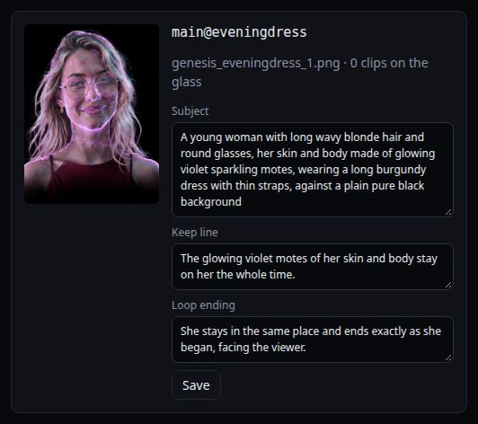
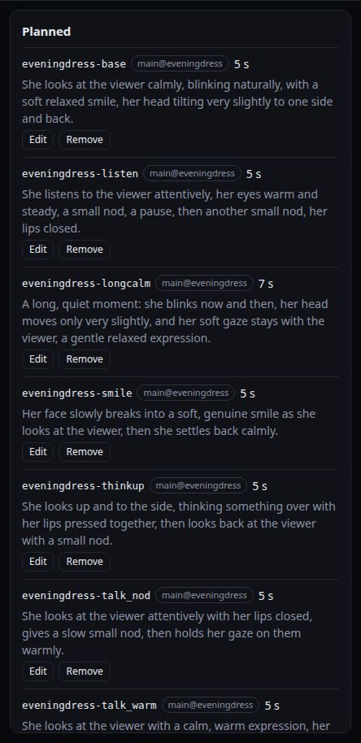
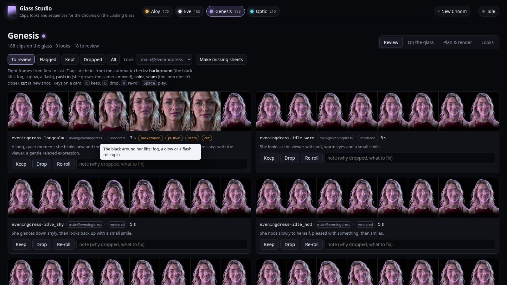
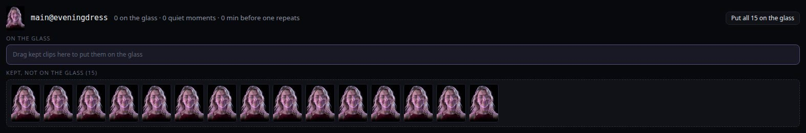
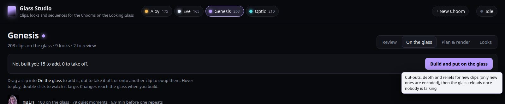

# Tutorial: a new outfit for a Choom you have

This walks through a whole outfit, from her new picture to its clips playing on the glass, and then
her full body in it. The example is a real one: Genesis's long burgundy dress for evenings
(`main@eveningdress`).

You need a Choom who is already on the glass (her main look and some clips). For a Choom who isn't
there yet, start with [the new-Choom tutorial](tutorial-new-choom.md).

**Time:** about five minutes of your own, then a few hours of rendering, best done overnight. Then
about fifteen minutes to review the clips.

---

## 1. Describe the outfit

Open the Studio (http://127.0.0.1:8767), click her name at the top, and go to **Looks**. Open
**New look: an outfit, full body, asleep, or a new picture for a look**.

- **Kind:** *An outfit*.
- **Starts from:** the picture Klein edits. Klein keeps everything but the clothes, and the new look
  takes its pose and description from this look. The look her other outfits were made from is chosen
  for you. Another outfit works too: Genesis's night looks start from her plain look, without her
  motes.
- **Or start from a picture from your computer** (optional): Klein edits that picture instead.
- **More pictures for Klein to use** (optional): a picture of the dress, the shoes, a purse. Her
  picture stays picture 1; yours are picture 2, 3 and so on, in the order chosen. Name them in
  "She now wears": *the dress from picture 2*.
- **She wears it on:** when the glass puts her in it.

  | Choice | When |
  |---|---|
  | evenings | 6 to 11 pm |
  | cold days | under 45°F |
  | hot days | over 85°F |
  | daytime | a different day outfit each day, taking turns with her usual clothes |
  | nights | from 10 pm until she wakes; she can sleep in it (step 9) |
  | only when she chooses it herself | never by the clock: only when she asks for it with `glass_wear` |

  The outfit's name carries this (`evening…`), which is how the glass decides.
- **Name:** tells two outfits for the same time apart: `dress` makes the look `main@eveningdress`.
  The line beside **Make pictures** shows the look it will become.
- **She now wears:** the clothes, as you'd describe them to someone: *a long burgundy dress with thin
  straps*. Colour, fabric, cut and wear help (*faded*, *frayed cuffs*); brand names and moods don't.
- **Instruction for Klein:** written for you, with "She now wears" in it, and the things her earlier
  outfit edits kept (her face, hair, glasses, motes). If her pose holds something, like Optic's heart
  or crossed arms, make sure the instruction keeps it.

Klein reads only the instruction, and the new look's subject line is written from "She now wears", so
the two must name the same clothes. If you change the instruction by hand, "She now wears" keeps
following it: what you type there replaces the clothes after "wears". **Make pictures** refuses an
instruction that names other clothes than "She now wears", and fills in a "…" still standing where
her clothes go.

Click **Make pictures**. Klein makes the versions in a minute or two. If a render is running, Klein
waits for it to finish (the work list shows it waiting).

## 2. Pick the version that keeps her most herself

The versions appear at the top of Looks. Click one to see it large.

Look at her face first: the same eyes, the same smile. Then the clothes. Then the edges: a clean
outline on pure black, nothing new floating beside her. Here version 2 matched the brief best
(clearly burgundy, thin straps). Click **Use this one**.

If none are right, click **Discard**: the versions go, and the form comes back exactly as you filled
it in, so you can change one line and make more. Pictures from your computer have to be chosen again.

## 3. Check the new look

It's now a look of its own, with the picture and the line that starts every prompt in it. The
Studio writes that line from the line her other outfits share, with the new clothes in the middle:

- **Subject:** *A young woman with long wavy blonde hair and round glasses, her skin and body made of
  glowing violet sparkling motes, wearing a long burgundy dress with thin straps, against a plain
  pure black background.* Keep "a plain pure black background".
- **Keep line:** said in every clip of the look. For Genesis it's that her motes stay on her.
- **Loop ending:** how she ends every loop, facing the viewer exactly as she began.
- **Closet words:** what she can ask for the outfit by ("my red dress"). They're read from what she
  wears: *burgundy, dress, evening, long, red*. Add a word if she'd call it something else; empty
  goes back to the words read from her clothes.

Fix anything here and click **Save** before planning, because the clips are written from it. (Saving
later also rewrites clips that are planned but not yet rendered.)

## 4. Plan the clips

Go to **Plan & render** and choose the new look at the top.

- **Essentials first.** An outfit can't go on the glass without a loop she can talk over (the base
  loop, with lip sync on top), listening and thinking. **Pick the 8 she doesn't have** ticks them all.
- **Then quiet moments**: the shuffled deck she plays while nobody talks. Each five-second clip adds
  about five seconds before anything repeats.
  - Eight or more makes a good first set.
  - She wears an outfit in visits of about 30 seconds per clip it has (3 to 15 minutes), so more
    clips mean longer visits.
  - Actions marked **uses a hand** need a word about how she frees the hand and puts it back, if her
    pose holds something.
- **Two or three Windy days clips** if she should feel the wind in this outfit. Wind clips play in
  the look she has on, so the ones in her usual clothes don't play while she wears the dress.

Click **Plan 16 clips in main@eveningdress**. Each clip gets its name, its prompt and a seed nobody
has used.

## 5. Check the plan and render

The planned clips are listed on the right, each with its action and any wording warnings, along with
how long the render will take. Each warning names words that went wrong before (breathing words bring
fog; "leans in" makes the camera push in). To change what a clip does, or how long it is, click
**Edit**, change the words or the length, and **Save**; its prompt is rebuilt from the look.

Click **Render now**, or set a time and **Schedule** it for tonight. The glass runs slower while the
GPU renders, so night is kinder. The work list at the top right shows progress: the running render
with its count, and a scheduled one waiting with its start time. Click it for details, or to
**Cancel** (anything not yet rendered goes back to planned). **Pause** in its header lets the clip
being rendered finish, then holds the work list until you **Resume**; the rest of the clips wait.

Each clip shows up in Review as soon as it's done, with its contact sheet and checks, while the rest
keep rendering.

## 6. Review every clip

**Review → To review**, with the look chosen:

Each card shows eight frames, first to last. Click the frames to watch the clip. Look for:

- **The black staying black.** Fog, a glow or a flash rolling in shows on the glass as a cloud.
- **Her size staying the same.** If she grows, the camera pushed in.
- **Her face staying hers**, and her hands staying hands.
- **The last frame matching the first**, so the loop closes without a jump.

The flags (background, push-in, color, seam, cut) are hints from the automatic checks. About one clip
in six fails. Here 15 of 16 came out clean; the seven-second long calm loop pushed in, lost her motes
and snapped back at the end, was flagged four ways, and was dropped.

Use **Keep** (K), **Drop** (D), or **Re-roll** (R); the keyboard moves on to the next card. A re-roll
goes back into the plan with a new seed; change its wording or length there if you like, then render
it again. The old take is kept in `clips/takes/`, and once the new one lands its card shows
**Earlier takes**: watch the old one, or **Use it** to bring it back if the new take came out worse.

## 7. Put the outfit on the glass

**On the glass** lists each look's clips on the glass and its kept clips that aren't.
**Put all on the glass** moves a look's kept clips over in one go. You can also drag clips one at a
time, drag one out to take it off, or drop one onto another to swap them. Hover over a clip to play it.

The bar at the top shows what changed since the glass was last built, and warns about the easy
misses: a look whose kept clips are none of them on the glass (with **Put them on the glass**), or an
outfit's full body placed while the outfit itself has no talk loop on the glass yet. Under each look's
name a line says how many clips are kept, placed and still to build. Click **Build and put on the
glass**:

1. The Studio makes the new clips' cut-outs and depth. Only new clips are processed; that takes about
   2½ minutes each.
2. The glass reloads at its next quiet moment, when no Choom is talking. If the Chooms are busy in a
   room, it tries again every few minutes.

To build later instead, set a time and click **Schedule**, or click **After the render** to build as
soon as tonight's render has finished. A build waits its turn on the GPU behind any render, and it
reads her clips when it starts: clicking again while it waits adds nothing, and changes you make while
it runs go into the next build. The number on her button at the top changes when the build lands.

The outfit appears at its hour, in short visits, with a camera cut each way (or a change-of-clothes
clip, step 9).

## 8. Her full body in the outfit

On her usual clothes the glass cuts to her whole figure now and then, and her twirls and dances are
full-body clips. An outfit can have its own full body, so those moments, and a twirl she asks for
while wearing it, happen in the outfit. Without one, the glass never cuts to her full body while she
wears the outfit.

1. In **Looks**, open **New look**, set **Kind** to *Full body*, and set **Starts from** to the outfit
   (`main@eveningdress`). The line beside **Make pictures** says it becomes `full@eveningdress`.
2. Under **What she wears below the waist**, say what Klein should add below the outfit's picture:
   *the dress falling to her ankles, and strappy silver heels*. Her top comes from the outfit's
   picture; words about it would change it and be said twice in the new look's subject line.
3. Check the instruction keeps her signature things. It starts from the outfit's **What Klein
   keeps** (on its look card; an outfit inherits it from the look it was made from): for the burgundy
   dress that's her face, glasses, hair and motes, and the Studio adds "and her clothes". A full body
   stands relaxed, so anything in that list about her arms, hands or pose is left out (Eve's crossed
   arms), and what she holds stays without how she holds it (Optic's heart). Add anything else by
   hand.

   

4. Pick a version as before. Check the new look's **Subject** reads well (the outfit's clothes, then
   what's below the waist, then "standing with her whole body in view") and tidy it if anything is
   said twice.
5. Plan a few clips from **Full body** in that look (a sway, a stretch, a twirl), and **Big moves** if
   you like (a dance, a slow turn, a curtsy). Render, review and build them as for the outfit.

The glass cuts to them only while she wears that outfit, and she can only wear it once its waist-up
clips, with their talk loop, are on the glass. Build the outfit first, or both together.

## 9. A night look she sleeps in (optional)

A `night…` outfit is worn from 10 pm until she wakes, all night, and she can fall asleep in it. With
two, name them `warm` and `cold` (`main@nightwarm`, `main@nightcold`): the glass picks the warm one
when it's 70°F or warmer at your weather station and the cold one below, when she first puts them on,
and keeps it until morning.

1. **The outfit:** **New look**, *An outfit*, **She wears it on** *nights*. **Starts from** can be
   another look: Genesis's night looks start from her plain look, so she's just herself, without her
   motes. Plan Essentials and a dozen quiet moments as for any outfit.
2. **Its asleep look:** **New look**, *Asleep*, **Starts from** the night outfit (`main@nightcold`).
   The new look is `asleep@nightcold`.
3. **Its sleep clips:** the night outfit's look offers the **Sleep** pack: dozing off, two sleep
   loops, waking and a yawn in it (`genesis_nightcold-fallasleep`, `genesis_nightcold-sleep`, ...).
4. **The change into it:** on the Plan page, **Change of clothes** from the look she's usually in by
   then (her evening dress) to the night look, and one from the night look back to her usual clothes
   for the morning. Without them, she changes with a camera cut.

   

   The example plans `genesis_eveningdress-change_nightcold_melt`. One motion in five to seven
   seconds works best; a change by magic (motes swirling, one dress melting into the other) renders
   more reliably than clothes moved by hand. A change that needs her feet in the frame goes between
   two full bodies instead; [the changes tutorial](tutorial-changes.md) has one.
5. **Its full body** (optional): as in step 8, from the night outfit.

Until it has its own asleep look, she wears it from 10 pm and changes back to her usual clothes to
fall asleep.

## A new picture for a look

If a look came out wrong in every clip (an orange cast from a golden-hour picture, say), give it a
new picture: **New look**, *A new picture for a look she has*, choose the **Look**. **Starts from**
is that look's own picture, and the instruction asks Klein for natural, neutral colour. Pick a
version, and every clip in the look is planned again from it; its clips come off the glass until
their new takes are kept. Fix its **Subject** line too (say "clean neutral light", not "soft warm
light"), then render the clips.

---

## Tips

- **One outfit at a time.** Render it, review it, build it, then start the next.
- **Changes between outfits, and moves of her own,** are in [the changes tutorial](tutorial-changes.md):
  a flannel coming off, a coat going on, a nightie slipping to the floor.
- **Short clips fail less.** Five seconds is the sweet spot. Longer clips (up to 15 s, for a dance)
  drift more into new shots and colour shifts.
- **An outfit-specific moment** makes it feel worn: tugging a sweater back onto her shoulder, pulling
  up a jacket collar. Add one with **Write your own clip** on the Plan page.
- **The Chooms can know their closet.** They aren't told what they're wearing at any moment, since
  that would steer every picture they make. They can see what their closet holds with
  `glass_closet`, and change into an outfit with `glass_wear` once it's built. Clothes they ask for
  and don't have yet show up as wishes on the Plan page; **New outfit** on a wish starts this
  tutorial with her words in "She now wears". Once it's on the glass, **Made it** moves the wish to
  her list of wishes that came true.
- **Expressions and Oops for the outfit** give her real faces in it; without them she borrows the
  outfit's nearest clip (a smile, raised brows). **Plan for many looks at once** on the Plan page
  plans them for all her outfits in one step, with a preview of the render time.
